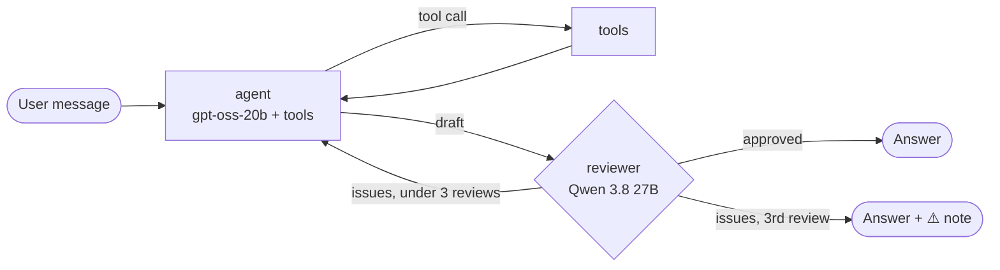
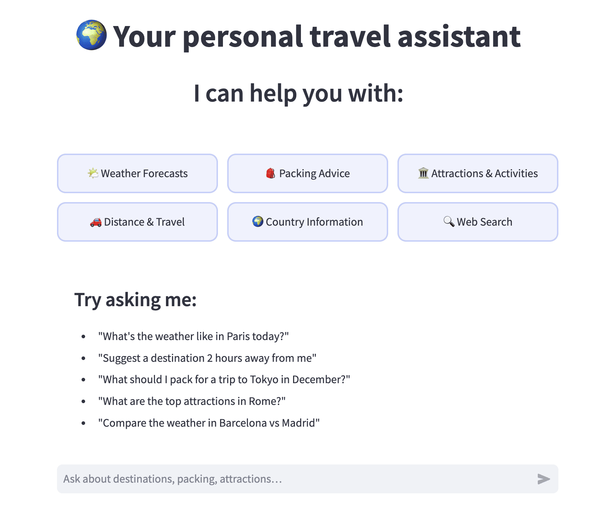
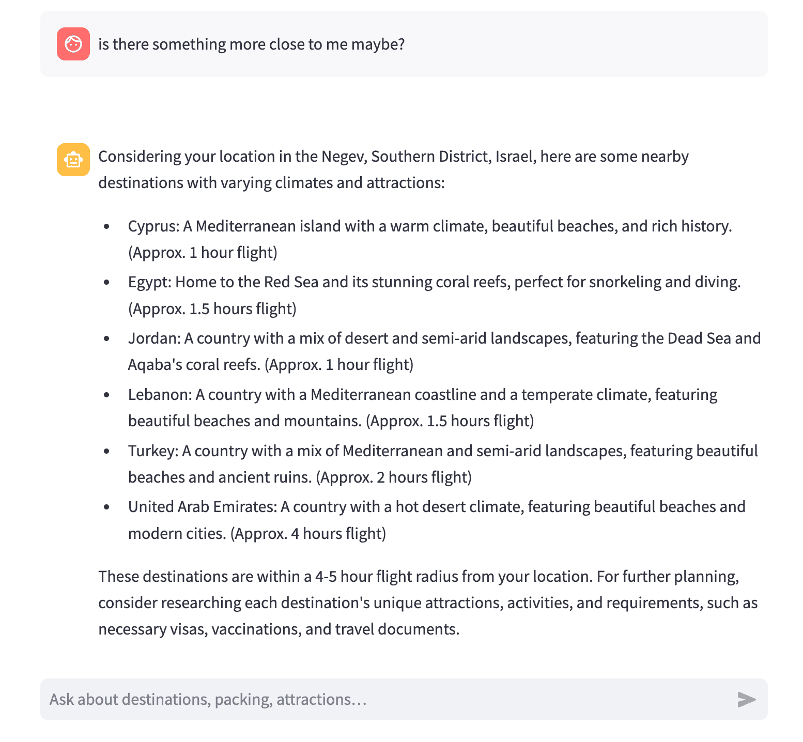
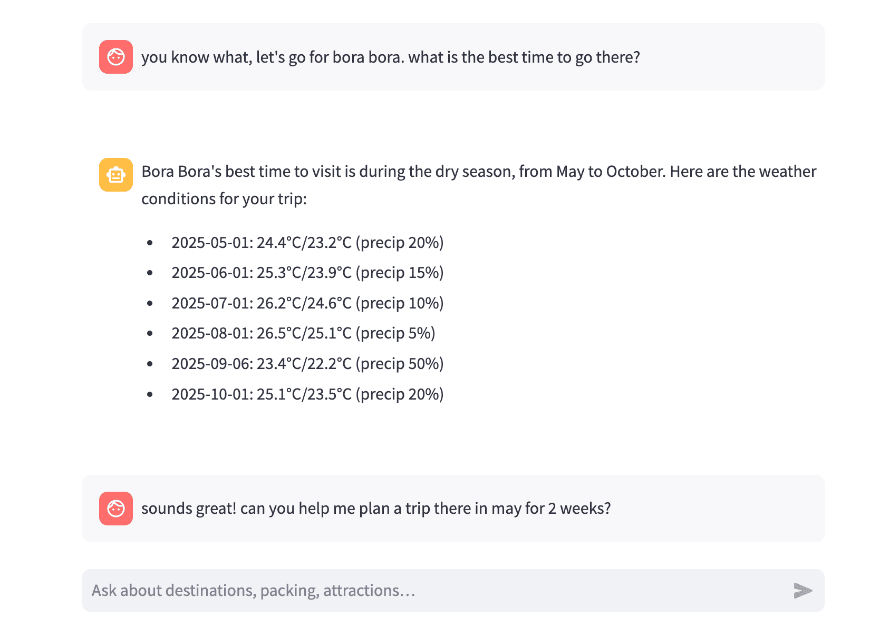

# ✈️ Travel Assistant: a tool-calling agent with a cross-model reviewer

[](https://github.com/lioka0099/Travel_Assistant/actions/workflows/tests.yml)

A travel-planning chat assistant built with LangGraph and Streamlit. The agent decides which tools to call (weather, drive times, web search and more), and a second model from a different family checks every answer against the tool results before the user sees it.

> Try it now → [travel-assistant-demo.streamlit.app](https://travel-assistant-demo.streamlit.app/)

## How it works



1. **Agent loop.** The agent model has six tools bound to it. It calls tools until it has what it needs, then writes a draft. Nothing in the code decides which tools to use; the model does. After 12 tool results for one message, the agent gets no more tools and must answer with what it has.
2. **Cross-model review.** A reviewer from a different model family (Alibaba's Qwen vs OpenAI's gpt-oss) checks the draft. It also gets today's date and the previous question and answer, so follow-ups make sense. It checks that:
   - every fact matches the tool results;
   - the question is answered;
   - nothing is invented;
   - ambiguity is handled;
   - the answer stays on travel.
3. **Bounded revisions.** Rejected drafts go back to the agent with the reviewer's feedback, and every revision is reviewed again, up to 3 reviews per message. If the last review still finds problems, the answer ships with an honest "⚠️ I couldn't double-check: …" note. If the reviewer model itself is unavailable (after one retry), the draft is shown marked "⚠️ I couldn't double-check this answer."
4. **Memory.** Conversation memory lives in LangGraph's checkpointer, one thread per browser session.

The whole graph is one file of about 100 lines: [`graph/agent.py`](graph/agent.py).

## Tools

| Tool | What it does | Source |
|---|---|---|
| `get_weather` | Daily forecast (max/min °C, chance of rain), up to 16 days ahead | [Open-Meteo](https://open-meteo.com/) |
| `get_travel_time` | Driving distance and time between two places | Open-Meteo geocoding + [OSRM](https://project-osrm.org/) |
| `get_country_info` | Capital, currencies, languages, region, dialing code | [mledoze/countries](https://github.com/mledoze/countries) |
| `web_search` | Top results with snippets | [Tavily](https://tavily.com/) |
| `get_local_time` | Current time in a timezone | Python `zoneinfo` |
| `get_user_location` | The user's city and coordinates | Browser geolocation |

Tool failures (a timeout, a service outage) come back to the agent as error messages, so it can retry or tell the user what it couldn't check instead of crashing.

## UX

The chat UI was designed against [Nielsen's 10 usability heuristics](https://www.nngroup.com/articles/ten-usability-heuristics/):

- **Live status in plain words** while the agent works ("Checking drive time to Haifa…"), never function names.
- **"How I got this"** under each answer: the steps taken, whether it was double-checked, and the sources. It's collapsed by default.
- **Clickable example questions**, a "What can I ask?" help popover, a New chat button and a visible location badge.
- **Errors in plain language**, with a Try again button.
- **Travel only.** Off-topic requests get a polite decline with an example question; this is enforced by both the agent's instructions and the reviewer.

## Run locally

Requires Python 3.13.

```bash
python -m venv .venv && source .venv/bin/activate
pip install -r requirements-dev.txt
streamlit run app.py
```

Settings go in a `.env` file or in Streamlit secrets:

| Variable | Purpose |
|---|---|
| `GROQ_API_KEY` | Required. LLM calls via Groq |
| `TAVILY_API_KEY` | Enables web search |
| `GROQ_MODEL` | Agent model; defaults to `openai/gpt-oss-20b` |
| `GROQ_REVIEW_MODEL` | Reviewer model; defaults to `qwen/qwen3.8-27b` |
| `LANGSMITH_TRACING`, `LANGSMITH_API_KEY` | Optional LangSmith tracing (`LANGSMITH_TRACING=true`) |

## Tests

```bash
pytest -q
```

The tests run offline in about 2 seconds. Scripted fake models drive every path through the graph: approval, revision, the review limit, a reviewer retry and outage, tool errors, the tool budget, long turns, and recovery after a failed or interrupted turn. Headless Streamlit `AppTest`s cover the UI.

## Screenshots

<div align="center">
  
  
  
</div>
