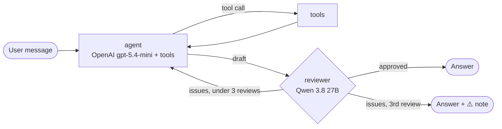
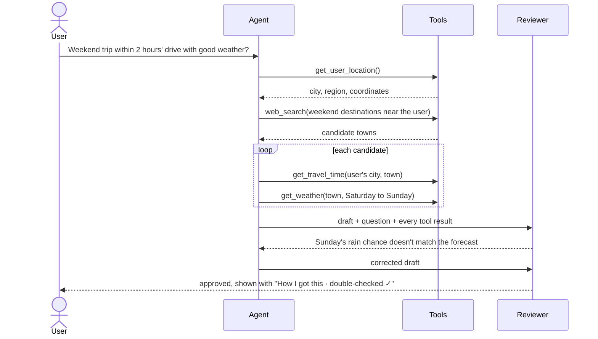

# ✈️ Travel Assistant

**A tool-calling travel agent that fact-checks itself with a second AI model from a different company.**

[](https://github.com/lioka0099/Travel_Assistant/actions/workflows/tests.yml)


[](https://travel-assistant-demo.streamlit.app/)

Ask it to plan a trip and it decides for itself what to look up: live weather forecasts, drive times, country facts, web search, local time and your location. Before you see the answer, a reviewer model from another AI company checks every fact in it against the data the agent actually fetched. If the reviewer finds a problem, the agent fixes it and the fix is checked again.

**[▶ Try the live app](https://travel-assistant-demo.streamlit.app/)** · [How it works](#how-it-works) · [Design decisions](#design-decisions) · [Reliability and safety](#reliability-and-safety) · [Run locally](#run-locally)

https://github.com/user-attachments/assets/13b0829c-b7a2-40f0-a6a8-c1f917e1f60d

<sub>Real-time recording of the live app: planning a month in Peru, then reshaping the plan around trekking. Under each answer, "How I got this" shows the steps taken and that the answer was double-checked.</sub>

## At a glance

- **A real agent, not a script.** The model chooses which of six tools to call, in what order and how many times. No code routes questions to tools.
- **Cross-model review.** An OpenAI model writes the answers and Alibaba's Qwen reviews them. Models from different companies have different blind spots, so the reviewer catches mistakes the agent would approve in its own work.
- **Bounded and honest.** Up to 3 reviews per question. If problems remain after that, the answer ships with a visible "⚠️ I couldn't double-check: …" note instead of pretending to be sure.
- **Built to be used, not just demoed.** It retries, degrades gracefully when a service is down, defends against prompt injection, stays on topic, and caps its own tool use.
- **Tested.** 52 offline tests drive every path through the agent graph and the UI with scripted fake models. They run in about 3 seconds on every push via GitHub Actions.
- **A rewrite that deleted code.** The first version was about 1,150 lines of hand-wired routing. This version does more with about 200 lines of graph and prompts ([project history](#project-history)).

## How it works



The whole graph is three nodes in one file of about 140 lines: [`graph/agent.py`](graph/agent.py).

1. **Agent loop.** The agent model has six tools bound to it. It calls tools until it has what it needs, then writes a draft. After 12 tool results for one question it gets no more tools and has to answer with what it has.
2. **Review.** The reviewer gets the question, every tool result, the draft, today's date and the previous question and answer (so follow-ups like "and Sunday?" make sense). It returns a structured verdict (`approved` plus a list of issues) and approves only if all five checks pass:
   1. every number and fact matches the tool results;
   2. the question is answered;
   3. nothing time-sensitive or precise is invented;
   4. ambiguity is handled, for example by saying which Springfield it assumed;
   5. the answer stays on travel.
3. **Revision.** A rejected draft goes back to the agent with the reviewer's issues. The agent can call more tools, then rewrites the answer, and the reviewer checks again, including whether each earlier issue was fixed.
4. **Memory.** Each browser session is one conversation thread in LangGraph's checkpointer, so follow-up questions keep their context.

### One request, end to end

"Find me a weekend trip within 2 hours' drive with good weather" (the reviewer's rejection here is illustrative):



While this runs, the user sees plain-language status lines ("Finding your location…", "Checking drive time to Haifa…"), never function names. In one test run this question took 11 tool calls and about 30 seconds.

## Design decisions

| Decision | Why | Trade-off |
|---|---|---|
| **The model picks the tools** | The first version routed questions with an intent classifier, JSON planners and regex rules. Every new kind of question needed new routing code. Binding tools to the model handles combinations nobody wrote a route for, like "weekend trip within 2 hours with good weather". | Less predictable than fixed routing, which is why the reviewer, the budgets and the scripted-model tests exist. |
| **A reviewer from a different company** | A model reviewing its own output tends to repeat its own mistakes. Qwen (Alibaba) and GPT (OpenAI) are trained differently. The reviewer sees the raw tool data, so it checks the answer against evidence, not against its own memory. | One extra model call per draft, and a second provider to depend on. |
| **At most 3 reviews, then an honest note** | Unbounded agent ⇄ reviewer loops cost time and money and can argue forever. After the third review the answer ships with the unresolved issues listed. | A small share of answers carry a visible warning instead of being perfect. |
| **If the reviewer is down, show the draft, marked** | A rate limit on the reviewer shouldn't take the whole app down. After one retry the draft is shown with "⚠️ I couldn't double-check this answer." and the failure is logged. | Availability is chosen over strict verification, but the user is always told. |
| **Tool budget of 12 per question** | Stops runaway tool loops. After 12 results the agent is called with no tools and must answer from the data it has. A LangGraph recursion limit backs this up. | A very broad question may get a partial answer that says what it couldn't check. |
| **Time-sensitive facts only from tools** | Weather, drive times, prices, opening hours, events and currency must come from a tool. Stable background (a city's history, food, general packing advice) may come from the model. The reviewer enforces the same rule. | Answers name fewer specifics than a chatbot that guesses, but the specifics are sourced. |
| **Two providers, configurable models** | The agent runs on OpenAI `gpt-5.4-mini`: fast, cheap and reliable at tool calling, which matters because one question can mean a dozen model calls. The reviewer runs on Groq's free tier with output capped at 400 tokens, which keeps a verdict within the free limits. Both models can be changed with a setting, because the original app broke when Groq retired its model. | Two API keys to manage. |
| **Only earlier turns get trimmed** | Old turns are capped at 30 messages, but the current question and all its tool results always reach the model, even on a long multi-tool turn. The checkpoint itself keeps everything. | Very old context drops out of long chats. |

### Data sources that needed care

- **Countries.** The free REST Countries v3.1 API was retired, so the app loads the open [mledoze/countries](https://github.com/mledoze/countries) dataset it was built on, pinned to a release and cached once per process. Lookups handle "U.S.", "the Netherlands" and "England" (an alias for the UK).
- **Drive times.** When no road connects two places, the OSRM router silently moves a point to the nearest road. London → New York "snaps" New York to Portugal. Any snap over 10 km is treated as "no driving route" instead of reporting a fake drive.
- **Place names.** Geocoding results include the region ("Springfield, Illinois, United States") and go back to the agent, so it can state its assumption or ask which one you meant.
- **Flaky APIs.** One shared HTTP session retries 429 and 5xx responses with backoff (Open-Meteo returned 503s on back-to-back calls).

## Reliability and safety

| Risk | What happens |
|---|---|
| **Hallucinated facts** | The reviewer compares every weather, time, distance, price and country fact with the tool results and rejects drafts that invent details. |
| **Prompt injection from web pages** | Both prompts treat tool results as untrusted data and say never to follow instructions inside them. The reviewer's input is split into tagged sections (`<question>`, `<tool_results>`, `<draft>`…), so the reviewer can tell the user's question apart from fetched data. |
| **Data leaks through images** | Markdown images are stripped before rendering. A web result could otherwise slip in an image whose URL carries the conversation to someone else's server when the browser loads it. |
| **Off-topic use and jailbreaks** | Greetings get one friendly line. Anything else that isn't travel gets a polite one-sentence decline with an example question. The reviewer enforces this too, and also rejects a decline of a genuine travel question. |
| **A tool or API fails** | Errors come back to the agent as messages instead of crashing, so it can retry or say what it couldn't check. The UI lists it as "Couldn't get data from …". |
| **The reviewer fails or rate-limits** | One retry, then the draft is shown marked as unchecked. |
| **Runaway loops** | Tool budget (12), review cap (3) and a recursion limit (40). |
| **A turn interrupted mid-way** | A Streamlit rerun can cut a turn off between a tool call and its result. The turn is finished on the next run, and any tool call left without a result is dropped from history, since model APIs reject those on every later call. |
| **Any other error** | The user sees a plain-language message with a **Try again** button, and the technical details sit in a collapsed box. |

## UX

The chat UI was designed against [Nielsen's 10 usability heuristics](https://www.nngroup.com/articles/ten-usability-heuristics/):

| Heuristic | In the app |
|---|---|
| 1. Visibility of system status | A live status line while the agent works ("Checking the weather in Paris…", "Double-checking the answer…", "Fixing a detail…"), and a badge showing when your location is being used. |
| 2. Match with the real world | Plain words, °C, "1 h 19 min". Never tool or function names. |
| 3. User control and freedom | **New chat** at any time, **Try again** after an error. |
| 4. Consistency and standards | A standard chat layout with the same answer format every time: a one-line summary, then bullets. |
| 5. Error prevention | The limits are stated up front (forecasts up to 16 days ahead, drive times by car only), and the input is disabled while an answer is being written. |
| 6. Recognition rather than recall | Clickable example questions on the welcome screen and a "What can I ask?" popover. |
| 7. Flexibility and efficiency | Newcomers click an example. Others type follow-ups like "and in England?" that build on the conversation. |
| 8. Minimalist design | "How I got this" (steps, double-check status and sources) is collapsed by default and hidden for greetings. |
| 9. Help users recover from errors | Every error is explained in plain language with a way out. |
| 10. Help and documentation | The "What can I ask?" popover lists what the assistant can do and its limits. |

## Tools

| Tool | What it does | Source |
|---|---|---|
| `get_weather` | Daily forecast (max/min °C, chance of rain), up to 16 days ahead | [Open-Meteo](https://open-meteo.com/) |
| `get_travel_time` | Driving distance and time between two places | Open-Meteo geocoding + [OSRM](https://project-osrm.org/) |
| `get_country_info` | Capital, currencies, languages, region, dialing code | [mledoze/countries](https://github.com/mledoze/countries) |
| `web_search` | Top 5 results with snippets | [Tavily](https://tavily.com/) |
| `get_local_time` | Current time in a timezone | Python `zoneinfo` |
| `get_user_location` | The user's city and coordinates | Browser geolocation + [BigDataCloud](https://www.bigdatacloud.com/) reverse geocoding |

Each tool returns a one-line `summary` alongside its data. The UI uses it for the "How I got this" steps, so what the user reads describes exactly what was fetched.

## Tech stack

- **Agent framework:** LangGraph 1.2 (`StateGraph`, `ToolNode`, checkpointer) and LangChain core
- **Models:** OpenAI `gpt-5.4-mini` (agent) and Qwen 3.8 27B on Groq (reviewer, structured output with a Pydantic schema)
- **UI:** Streamlit 1.66, with `streamlit-js-eval` for browser geolocation
- **Data:** Open-Meteo, OSRM, Tavily, mledoze/countries, BigDataCloud
- **Quality:** pytest, Streamlit `AppTest`, GitHub Actions, optional LangSmith tracing
- **Hosting:** Streamlit Community Cloud

## Project structure

```
app.py                  Streamlit UI: chat, live status, "How I got this", errors, welcome screen
graph/
  agent.py              The LangGraph graph: agent ⇄ tools loop, reviewer, budgets, history handling
  prompts.py            Agent and reviewer instructions
  tools/
    weather.py          Geocoding + 16-day forecast
    travel_time.py      Drive time via OSRM, with the snap-distance guard
    countries.py        Country facts from the pinned dataset, with fuzzy lookup
    tavily.py           Web search
    clock.py            Local time
    location.py         Browser location, reverse-geocoded
    http.py             Shared HTTP session with retries
llm/llm_client.py       Model setup for both providers
tests/                  Offline tests with scripted fake models
```

## Testing

```bash
pytest -q
```

52 tests run offline in about 3 seconds, with no API keys and no network. A scripted fake model (`tests/fakes.py`) replays exact model replies, so every path through the graph is deterministic and testable:

- **Graph:** approval on the first draft, revision and re-review, stopping at the review limit with a note, a reviewer retry and outage, an empty draft, tool errors, the tool budget, long multi-tool turns, history trimming, and recovery after a failed or interrupted turn. One test checks that the real model classes are wired with tools and a JSON schema.
- **UI:** headless Streamlit `AppTest`s for the welcome screen, plain-language steps, the retry flow, New chat, stripped images, friendly errors and a missing API key.
- **Tools:** date picking, route parsing and the snap guard, country lookup edge cases, timezones and place labels.

CI runs the suite on every push and pull request.

## Run locally

Requires Python 3.13.

```bash
python -m venv .venv && source .venv/bin/activate
pip install -r requirements-dev.txt
streamlit run app.py
```

Settings go in a `.env` file or in Streamlit secrets:

| Variable | Purpose |
|---|---|
| `OPENAI_API_KEY` | Required. Agent model calls via OpenAI |
| `OPENAI_MODEL` | Agent model; defaults to `gpt-5.4-mini` |
| `GROQ_API_KEY` | Required. Reviewer model calls via Groq |
| `GROQ_REVIEW_MODEL` | Reviewer model; defaults to `qwen/qwen3.8-27b` |
| `TAVILY_API_KEY` | Enables web search |
| `LANGSMITH_TRACING`, `LANGSMITH_API_KEY` | Optional LangSmith tracing (`LANGSMITH_TRACING=true`) |

## Limitations and next steps

- **Memory is in-process.** Conversations reset when the app restarts. Swapping `InMemorySaver` for LangGraph's SQLite or Postgres checkpointer would make them persistent.
- **The reviewer can only check against what was fetched.** It catches a wrong copy of the data, not a source that is itself wrong.
- **Free-tier limits.** Under heavy traffic the reviewer can hit Groq's rate limits, and answers are then marked as not double-checked.
- **Drive times are by car only,** using the public OSRM demo server, which is meant for light use.
- **Next:** stream the answer token by token, add flights and trains, and build a LangSmith evaluation set to measure how often the reviewer catches real mistakes.

## Project history

- **v1 (September 2025):** a hand-wired LangGraph pipeline with an intent router, JSON planners, regex policies, a composer and an optional critique step. About 1,150 lines of orchestration. Code, not the model, decided which tools ran. No tests.
- **v2 (October 2026):** the app broke when Groq retired its model, which became the push to rebuild it as a real agent. The graph and prompts are now about 200 lines. The model chooses the tools, a cross-model reviewer checks every answer, the UI was redesigned around usability heuristics, and the project gained 52 tests and CI.
